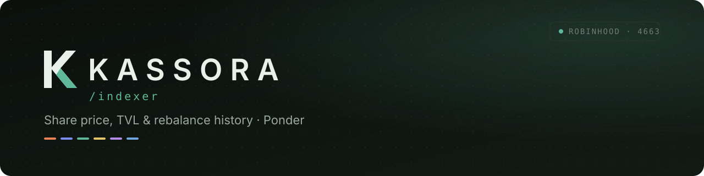
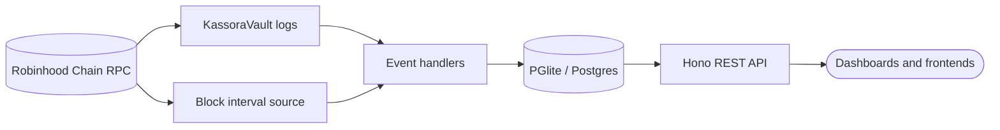

<div align="center">



<h3>Share price, TVL, allocations and governance history for Kassora vaults</h3>

<p>
  
  
  
  
  
  <a href="./LICENSE"></a>
</p>

<p>
  <a href="#-what-it-tracks">What it tracks</a> ·
  <a href="#-quickstart">Quickstart</a> ·
  <a href="#-configuration">Configuration</a> ·
  <a href="#-api">API</a> ·
  <a href="#-deploy">Deploy</a>
</p>

</div>

## 📊 What it tracks

The indexer follows every [`KassoraVault`](https://github.com/kassoradev/kassora-contracts) event on Robinhood Chain. It serves a small REST API for dashboards and frontends.

| | Data | Source |
| --- | --- | --- |
| 🏦 | Vault state: TVL, supply, share price, fee, timelock, deposit cap, roles, pause | Events plus on-chain reads |
| 📈 | Share price and TVL time series | Every vault event, and every `SNAPSHOT_INTERVAL_BLOCKS` blocks |
| 🧩 | Strategies: cap, pending cap, assets, enabled | Strategy events plus `totalAssets()` reads |
| 👤 | Per-account positions, deposits and withdrawals | `Deposit`, `Withdraw`, `Transfer` |
| 🗳 | Rebalance and governance feed | `Allocate`, `SetCap`, `SetFee`, `ForceRemoveStrategy`, and more |



> [!NOTE]
> **Revert-tolerant by design.** A vault's `totalAssets()` reverts while one of its strategies is broken. The indexer logs a warning, skips that snapshot and keeps indexing. It recovers on its own once the guardian calls `forceRemoveStrategy`.

**Share price.** `sharePrice` is `vault.convertToAssets(10 ** vaultDecimals)` at a block. That is USDG base units per whole kUSDG share. A `sharePrice` of `"1005399"` means 1 kUSDG = 1.005399 USDG.

<details>
<summary><b>Database tables</b></summary>

| Table | Contents |
| --- | --- |
| `vault` | Current state of each vault |
| `vault_snapshot` | Time series of totals and share price |
| `strategy` | Each strategy's target, cap, pending cap, assets and status |
| `user_position` | Shares, deposited and withdrawn per account |
| `deposit_withdraw` | Every deposit and withdrawal |
| `vault_event` | Rebalance and governance feed |

Schema: [`ponder.schema.ts`](./ponder.schema.ts). ABIs in [`abis/`](./abis) are copied from the contracts build output. Copy them again whenever the contracts change.

</details>

## 🚀 Quickstart

```bash
pnpm install
cp .env.example .env.local   # set CHAIN_ID, PONDER_RPC_URL_<id>, VAULT_ADDRESS, VAULT_START_BLOCK
pnpm dev                     # indexes and serves http://localhost:42069 with hot reload
```

| Command | What it does |
| --- | --- |
| `pnpm dev` | Index and serve with hot reload |
| `pnpm start` | Production mode |
| `pnpm codegen` | Regenerate `ponder-env.d.ts` |
| `pnpm typecheck` | `tsc --noEmit` |

<details>
<summary><b>Run against a local anvil chain</b></summary>

```bash
anvil --port 8560 --chain-id 31337

# in ../kassora-contracts, using anvil's first key
PK=$(cast wallet private-key "test test test test test test test test test test test junk" 0)
forge script script/DeployMockUSDG.s.sol --rpc-url http://127.0.0.1:8560 --private-key $PK --broadcast
ASSET=<tUSDG> TARGET_VAULT=<target> DEPOSITCAP=10000000000000 STRATEGY_CAP=5000000000000 INITIAL_TIMELOCK=0 \
  forge script script/Deploy.s.sol --rpc-url http://127.0.0.1:8560 --private-key $PK --broadcast

# back in this repo
CHAIN_ID=31337 PONDER_RPC_URL_31337=http://127.0.0.1:8560 VAULT_ADDRESS=<vault> \
  VAULT_START_BLOCK=0 SNAPSHOT_INTERVAL_BLOCKS=5 pnpm dev
```

</details>

## ⚙️ Configuration

| Variable | Required | Default | Description |
| --- | :-: | --- | --- |
| `CHAIN_ID` | | `4663` | `4663` mainnet, `46630` testnet, `31337` anvil |
| `PONDER_RPC_URL_<CHAIN_ID>` | ✅ | | RPC for the selected chain. The testnet has no default. |
| `VAULT_ADDRESS` | ✅ | | Vault address. A comma-separated list indexes several vaults. |
| `VAULT_START_BLOCK` | | `0` | `deployedAtBlock` from `kassora-contracts/deployments/<chainId>.json` |
| `SNAPSHOT_INTERVAL_BLOCKS` | | `3600` | Periodic snapshot interval. Pick it from the chain's block time. |
| `DATABASE_URL` | prod | | Postgres connection string. Unset means embedded PGlite in `.ponder/`. |
| `DATABASE_SCHEMA` | prod | | Postgres schema for `ponder start` |
| `PONDER_POLLING_INTERVAL_MS` | | `1000` | Realtime RPC polling interval |

**Mainnet reference.** Chain `4663`, explorer [robinhoodchain.blockscout.com](https://robinhoodchain.blockscout.com), gas in ETH, USDG at `0x5fc5360D0400a0Fd4f2af552ADD042D716F1d168` with 6 decimals.

## 🔌 API

Base URL is `http://localhost:42069` locally. Every endpoint is `GET` with CORS `*`.

| Endpoint | Returns |
| --- | --- |
| [`/vaults`](#get-vaults) | Every indexed vault |
| [`/vaults/:address`](#get-vaultsaddress) | One vault |
| [`/vaults/:address/snapshots`](#get-vaultsaddresssnapshots) | Share price and TVL series |
| [`/vaults/:address/allocations`](#get-vaultsaddressallocations) | Strategies with cap and assets |
| [`/vaults/:address/events`](#get-vaultsaddressevents) | Rebalance and governance feed |
| [`/vaults/:address/apy`](#get-vaultsaddressapy) | 7-day and 30-day APY |
| [`/health`, `/ready`, `/status`](#health-checks) | Served by Ponder |

**Conventions**

- Addresses come back lowercase. `:address` accepts any casing.
- uint256 values are **decimal strings** in raw base units. `timestamp`, `blockNumber`, `logIndex`, `decimals` and `chainId` are JSON numbers.
- `fee` is WAD, so `"100000000000000000"` means 10%. `timelock` is in seconds.
- Errors return `400 {"error": "..."}` for bad input and `404 {"error": "vault not found"}`.

The examples below come from an end-to-end run on anvil. The run deposited 1,000 tUSDG, allocated 600, added 8 days and 6 tUSDG of yield, withdrew 500, deallocated 50, and used a 10% fee.

#### `GET /vaults`

Array of vault objects, oldest deployment first.

<details>
<summary>Example response</summary>

```json
[
  {
    "address": "0x9fe46736679d2d9a65f0992f2272de9f3c7fa6e0",
    "chainId": 31337,
    "name": "Kassora USDG Vault",
    "symbol": "kUSDG",
    "asset": "0x5fbdb2315678afecb367f032d93f642f64180aa3",
    "decimals": 12,
    "totalAssets": "505999999",
    "totalSupply": "503282274713862",
    "sharePrice": "1005399",
    "fee": "100000000000000000",
    "timelock": "0",
    "depositCap": "10000000000000",
    "paused": false,
    "owner": "0xf39fd6e51aad88f6f4ce6ab8827279cfffb92266",
    "curator": "0xf39fd6e51aad88f6f4ce6ab8827279cfffb92266",
    "guardian": "0xf39fd6e51aad88f6f4ce6ab8827279cfffb92266",
    "feeRecipient": "0xf39fd6e51aad88f6f4ce6ab8827279cfffb92266",
    "updatedAt": 1795615982,
    "updatedAtBlock": 30
  }
]
```

</details>

#### `GET /vaults/:address`

One vault object with the same shape, or `404`.

#### `GET /vaults/:address/snapshots`

Query: `interval=hour|day` (default `day`) and `limit=N`. The default limit is 168 for `hour` and 90 for `day`, with a maximum of 2000. Results are **ascending**, one point per bucket, using the last snapshot in each bucket.

<details>
<summary>Example response</summary>

```json
[
  {"timestamp":1794924782,"blockNumber":10,"totalAssets":"1000000000","totalSupply":"1000000000000000","sharePrice":"1000000"},
  {"timestamp":1795615982,"blockNumber":30,"totalAssets":"505999999","totalSupply":"503282274713862","sharePrice":"1005399"}
]
```

</details>

#### `GET /vaults/:address/allocations`

Every strategy the vault has referenced, enabled ones first. `assets` is the strategy's `totalAssets()` at the last refresh. `pendingCap` is a submitted cap that has not been accepted yet, where `"0"` means none. `addedAt` is null while a strategy is only submitted.

<details>
<summary>Example response</summary>

```json
[
  {
    "strategy": "0xcf7ed3acca5a467e9e704c703e8d87f634fb0fc9",
    "target": "0xe7f1725e7734ce288f8367e1bb143e90bb3f0512",
    "cap": "5000000000000",
    "pendingCap": "0",
    "assets": "455999999",
    "enabled": true,
    "addedAt": 1794924767
  }
]
```

</details>

#### `GET /vaults/:address/events`

Rebalances and governance actions, **newest first**.

| Query | Description |
| --- | --- |
| `type` | Optional comma-separated filter, for example `Allocate,Deallocate` |
| `limit` | Default 50, maximum 500 |
| `cursor` | `<blockNumber>:<logIndex>`, exclusive. Pass the last item's `cursor`, or the `X-Next-Cursor` header that is set when a page is full. |

<details>
<summary>Event types</summary>

`Allocate`, `Deallocate`, `EmergencyExit`, `ForceRemoveStrategy`, `SubmitCap`, `SetCap`, `RevokePendingCap`, `StrategyAdded`, `StrategyRemoved`, `SetWithdrawQueue`, `SubmitFee`, `SetFee`, `RevokePendingFee`, `SubmitTimelock`, `SetTimelock`, `RevokePendingTimelock`, `SetDepositCap`, `SetCurator`, `SetGuardian`, `SetFeeRecipient`, `Paused`, `Unpaused`, `OwnershipTransferStarted`, `OwnershipTransferred`, and `AccrueFee` when fee shares were minted.

</details>

<details>
<summary>Example response</summary>

```json
[
  {
    "type": "Deallocate",
    "txHash": "0x17cc8f723104ddbbf65bf14d1bf255840ae14ad78c1ee3a9429d96037138cd43",
    "blockNumber": 23,
    "logIndex": 4,
    "timestamp": 1795615982,
    "args": {"strategy":"0xcf7ed3acca5a467e9e704c703e8d87f634fb0fc9","requested":"50000000","withdrawn":"50000000"},
    "cursor": "23:4"
  },
  {
    "type": "AccrueFee",
    "txHash": "0xcea0457cef15f4f852d271b5ece8d2b42e8a82e2176fe0a9ce4be9bd7e200b15",
    "blockNumber": 22,
    "logIndex": 1,
    "timestamp": 1795615982,
    "args": {"newTotalAssets":"1005999999","feeShares":"596776407403"},
    "cursor": "22:1"
  }
]
```

</details>

#### `GET /vaults/:address/apy`

Annualized, compounded yield from the share-price change between the latest snapshot and the latest one at least 7 or 30 days older. The formula is `(p1 / p0) ^ (365d / elapsed) - 1`. The value is net of the performance fee, and `null` when history is too short. `asOf` is the latest snapshot's timestamp.

```json
{"apy7d":0.2784735057757768,"apy30d":null,"asOf":1795615982}
```

The anvil run squeezes a 0.54% gain into 8 days, which is why the number is large.

#### Health checks

Ponder reserves these routes.

| Route | Response |
| --- | --- |
| `/health` | `200` with an empty body once the process is up |
| `/ready` | `200` once backfill is done, `503` before. Use this for load balancers. |
| `/status` | Latest indexed block per chain |

## ☁️ Deploy

Any Node 22 host works. One service runs both indexing and the API.

**Railway or Render**

1. Create a Postgres database and a web service from this repo.
2. Build with `pnpm install --frozen-lockfile`. Start with `pnpm start`.
3. Set `DATABASE_URL`, `DATABASE_SCHEMA` (for example `kassora_v1`), `CHAIN_ID`, `PONDER_RPC_URL_<id>`, `VAULT_ADDRESS`, `VAULT_START_BLOCK` and `SNAPSHOT_INTERVAL_BLOCKS`. Ponder listens on `PORT`, which both platforms set.
4. Set the health check path to `/ready`.

> [!TIP]
> Use a **new `DATABASE_SCHEMA`** for every deployment that changes the schema or indexing logic. Ponder re-indexes into the new schema while the old deployment keeps serving. Switch traffic once `/ready` returns 200. RPC responses are cached in the database, so re-indexing is cheap.

- Extra replicas can run `ponder serve` against the same database and schema to scale the API.
- Use a paid or dedicated RPC on mainnet. The public endpoint may rate-limit backfills.

## 🌐 The Kassora stack

| Repo | Purpose |
| --- | --- |
| [kassora-contracts](https://github.com/kassoradev/kassora-contracts) | Vaults and strategies |
| **kassora-indexer** | Share price, TVL and rebalance history API. You are here. |

## 📄 License

[MIT](./LICENSE) © Kassora
